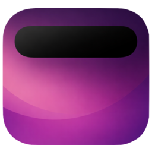
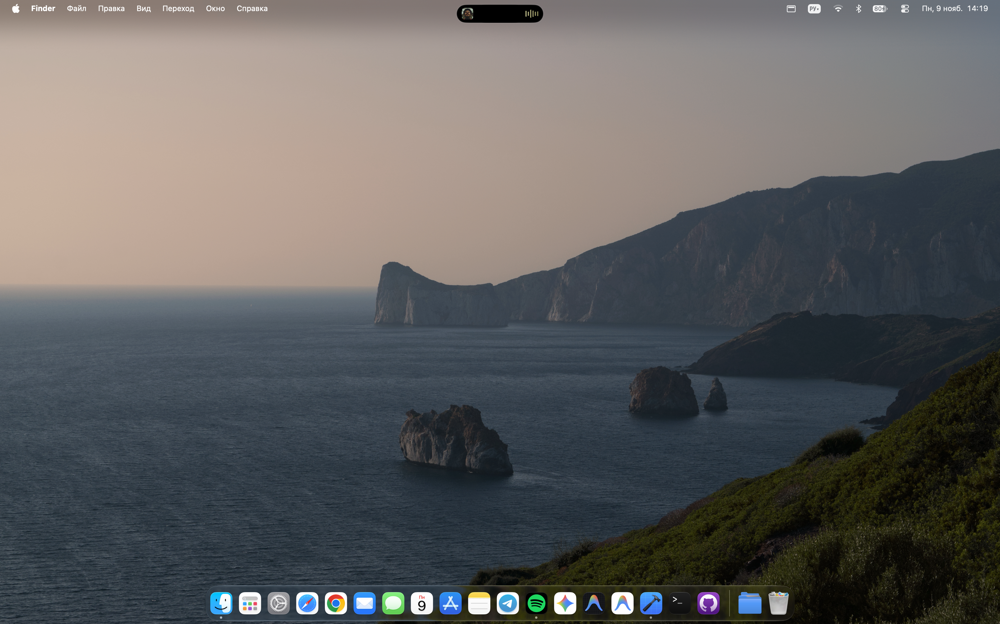
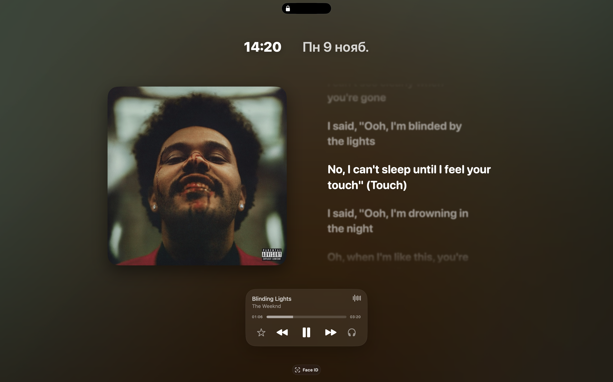
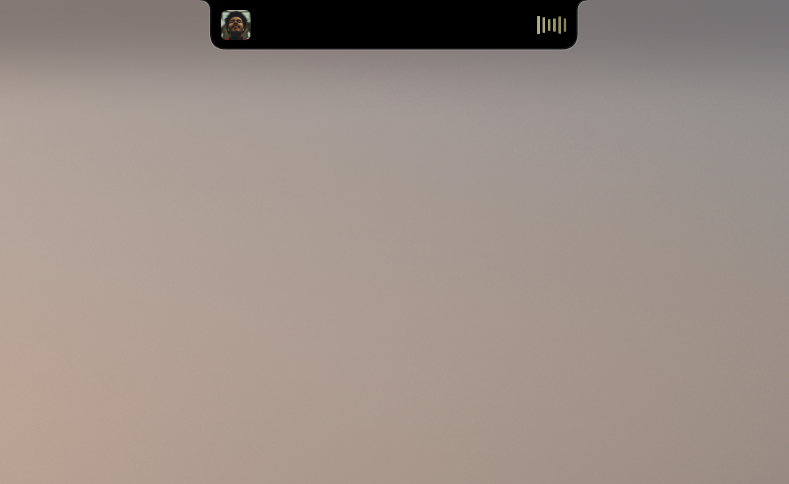
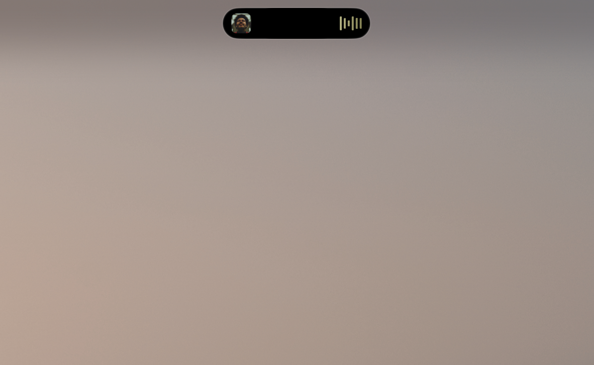
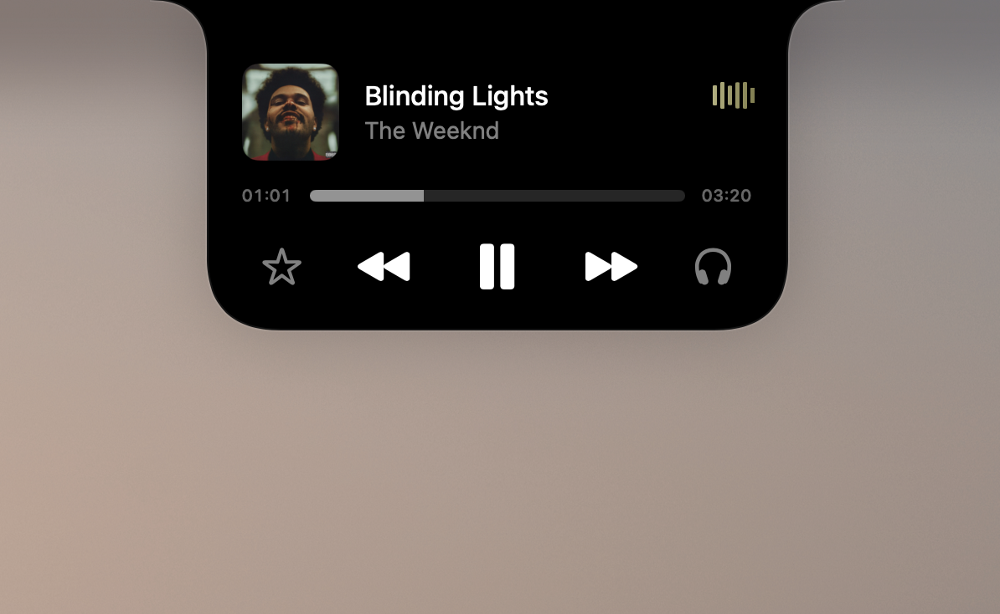
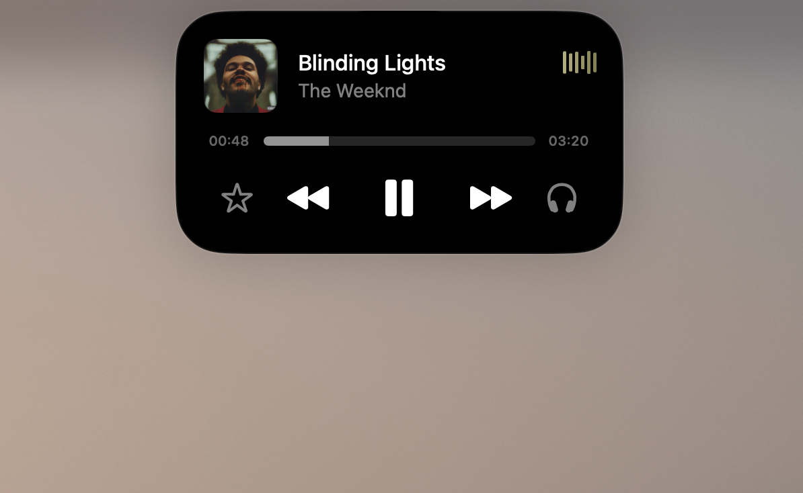

<p align="center">
  
</p>

<h1 align="center">DynamicNotch</h1>

<p align="center">
  <strong>The native Dynamic Island and notch experience for macOS.</strong>
</p>

<p align="center">
  DynamicNotch is a native macOS app for notched MacBooks that turns the notch into a live system surface for media,
  downloads, AirDrop, timers, screen recording, connectivity events, lock-screen transitions, and custom hardware HUDs.
</p>

<p align="center">
  <a href="https://github.com/jackson-storm/DynamicNotch/releases">
    
  </a>
  <a href="https://github.com/jackson-storm/DynamicNotch/releases/latest">
    
  </a>
  <a href="LICENSE">
    
  </a>
  
</p>

<p align="center">
  <a href="https://t.me/Dynamic_Notch">
    
  </a>
  <a href="mailto:evgeniy.petrukovich@icloud.com?subject=A%20question%20about%20Dynamic%20Notch">
    
  </a>
</p>

<p align="center">
  
  
</p>

## 🎯 Highlights

- **Live Activities**: Now Playing (media control, album artwork, audio visualizer, customizable progress bar tint style), Downloads progress, AirDrop, Timer, Screen Recording indicator, Focus mode, Personal Hotspot, and Lock Screen media/live activity surfaces.

- **Temporary Alerts**: Interactive HUD status for battery charging, low/full battery, Bluetooth connections, Wi-Fi, VPN, Focus-off toggling, and notch size modification settings feedback.

- **Gestures & Swipe Controls**: Native interactive gestures including mouse drag, trackpad swipes, vertical swipe-to-dismiss/restore with adaptive corner radii and swipe-aware blur, and horizontal trackpad/mouse scroll-to-dismiss.

- **Fluid Physics Animations**: True-to-life replication of the iOS Dynamic Island's motion design, featuring responsive physics-based spring animations, jelly-like morphing transitions, and synchronized content interpolation that matches the stretch, squash, and elastic behavior of Apple's implementation.

- **Dynamic Island (Floating Capsule)**: Automatic support for devices without a physical hardware notch (e.g. non-notched MacBooks, iMac, Mac mini, or external monitors). Transitions to a floating capsule shape (`DynamicIslandShape`) when `topInset == 0`, utilizing dynamic, smooth corner radius transitions.

## 💻 Preview

<table align="center" cellpadding="0" cellspacing="0" width="100%">
  <tr>
    <td align="center" width="10%"><b>Compact</b></td>
    <td width="45%"></td>
    <td width="45%"></td>
  </tr>
  <tr>
    <td align="center" width="10%"><b>Expanded</b></td>
    <td width="45%"></td>
    <td width="45%"></td>
  </tr>
</table>

> **Note:** This gallery displays only a selection of the events, live activities, and temporary alerts supported by DynamicNotch. Many other states, animations, and system transitions are supported.

## 📦 Installation

1. Download the latest DMG from the [Releases](https://github.com/jackson-storm/DynamicNotch/releases) page.
2. Drag `DynamicNotch` into `Applications`.
3. Launch the app.
4. Grant the permissions needed for the features you want to use.
5. If macOS blocks the first launch, allow it from `System Settings > Privacy & Security`.

## 🛠️ Build From Source

```bash
git clone https://github.com/jackson-storm/DynamicNotch.git
cd DynamicNotch
open DynamicNotch.xcodeproj
```

Then run the `DynamicNotch` scheme from Xcode. Swift Package Manager dependencies are resolved by the project.

## 💖 Support

Without your support, the project will not be able to develop. If you would like to support the project, you can do so via:

- **USDT (TRC-20)**: `TWYo42HQNuXSA5gmVoVV1973ScPqCtduvA`

- **USDT (ERC-20)**: `0xd3261630d7EC2484A3fcf5315f194B58834ab891`

- **Bitcoin (BTC)**: `bc1qw29074zwlp600rhvjat2v7ks53h835tthfj7dx`

## 🤝 Acknowledgements

Special thanks to the following open-source projects and services that make DynamicNotch possible:

- [Lottie for iOS](https://github.com/airbnb/lottie-ios) — for rendering premium, smooth vector animations.
- [LRCLIB](https://lrclib.net) — for providing the main engine for synchronized lyrics search.
- [Lyrics.ovh](https://lyrics.ovh) — for serving as a fallback database for static song lyrics.
- [mediaremote-adapter](https://github.com/ungive/mediaremote-adapter) — for MediaRemote API integration.

## 📄 License

DynamicNotch is released under the GNU General Public License v3.0. See [LICENSE](LICENSE) for details.
